# Ortsanalyse – Mapping-Tool für Architektur

Eine Website, mit der man auf einer Karte ein Gebiet von bis zu 1 km² aufzieht und daraus automatisch
**Schwarzplan, Straßennetz, Grünplan, Lageplan, Sonnen- und Schattenstudie, 3D-Modell, Schnitt und Ansicht, Flurstücke mit Bodenrichtwerten,
Mietpreise, eine Überschlagsrechnung zur Wirtschaftlichkeit und Kennzahlen** bekommt. Alle Pläne lassen sich **maßstäblich mit Plankopf als PDF, PNG, SVG und
als DXF für Allplan 2024 und ArchiCAD 29** exportieren.

Entstanden als Studienprojekt für Architekturstudierende. Die Daten kommen automatisch aus offenen Quellen
(OpenStreetMap und dem Landesamt für Geoinformation Niedersachsen, LGLN). Es gibt nichts zu installieren außer Python zum lokalen Start, oder man nutzt die Live-Demo.


*Lageplan des Testgebiets Oldenburg Innenstadt (800 × 778 m), erzeugt mit dem Tool.*

**Live-Demo:** https://jade-hs-vibecoding-wpk.github.io/Mapping-Tool-Architektur/

| Hell | Dunkel |
|---|---|
|  | 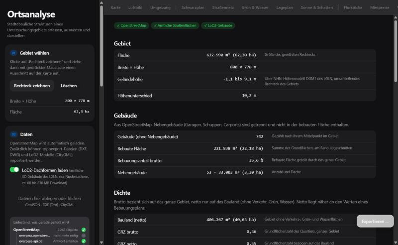 |

*Die Oberfläche folgt der Einstellung des Geräts (hell oder dunkel). Karte, Pläne und Exporte bleiben immer hell und schwarz-weiß.*

| | |
|---|---|
| **Projekt von** | _[Namen der Gruppe eintragen]_ |
| **Kurs / Dozent\*in** | _[Kurs und Dozent\*in eintragen]_ |
| **Stand** | _[Datum der Abgabe eintragen]_ |
| **Lizenz** | MIT License (siehe [`LICENSE`](LICENSE)) |

---

## Inhalt

1. [Auf einen Blick](#auf-einen-blick)
2. [Schnellstart](#schnellstart)
3. [Die Reiter im Einzelnen](#die-reiter-im-einzelnen)
4. [Export](#export)
5. [Datei-Import und Projekt merken](#datei-import-und-projekt-merken)
6. [Datenquellen und Lizenzen](#datenquellen-und-lizenzen)
7. [Genauigkeit und Grenzen](#genauigkeit-und-grenzen)
8. [Technik und Aufbau](#technik-und-aufbau)
9. [Hinweis zur Nutzung von KI](#hinweis-zur-nutzung-von-ki)
10. [Offen](#offen)

---

## Auf einen Blick

| Gruppe | Reiter | Was man bekommt |
|---|---|---|
| Orientierung | **Luftbild**, **Umgebung** | amtliche Luftbilder mit Linien; Kitas, Schulen, Läden, Haltestellen, Denkmäler und Gehzeit-Kreise |
| Pläne und Sonne | **Schwarzplan** (auch nach Höhe), **Straßennetz**, **Grün & Wasser**, **Lageplan**, **Sonne & Schatten** | Pläne wie im Entwurfsstudio; Schattenplan und Besonnungsdauer für jedes Datum |
| Grundstück und Markt | **Flurstücke**, **Mietpreise**, **Wirtschaftlichkeit** | Bodenrichtwert, GRZ/GFZ, Miete, Ertragswert und Neubau-Potenzial je Flurstück, jede Zahl mit Quelle |
| Darstellung | **Schnitt & Ansicht**, **3D-Modell** | Schnitt und Straßenansicht entlang einer gezogenen Linie (mehrere Linien); 3D mit Dachformen, Gelände und Schatten |
| Zahlen | **Kennzahlen** | GRZ/GFZ brutto und netto, Dichte, Grün, Verkehr und mehr |

**Dazu:** Export aus jedem Reiter (PDF, PNG, SVG, DXF, GeoJSON, CSV), Datei-Import (GeoJSON, Text-DXF, CityGML) und automatisches Merken des letzten Stands im Browser.

---

## Schnellstart

**Variante A: Live-Demo im Browser (nichts installieren)**

**https://jade-hs-vibecoding-wpk.github.io/Mapping-Tool-Architektur/**

Die Seite läuft über GitHub Pages direkt aus diesem Repository, es ist kein eigener Server nötig. Die Datendienste sind bei den ersten Aufrufen manchmal überlastet
(Overpass meldet gelegentlich Fehler 502); das Tool probiert dann andere Server. Die Dachformen (LoD2) sind ein Download von 60 bis 230 MB, bei schwacher Leitung das
Häkchen „LoD2-Dachformen laden“ abschalten.

**Variante B: lokal auf dem eigenen Rechner (Windows)**

1. [Python](https://www.python.org/downloads/) installieren (einmalig). Beim Installieren „Add python.exe to PATH“ anhaken.
2. Dieses Repository herunterladen (grüner Knopf „Code“ → „Download ZIP“) und entpacken.
3. Im Ordner auf **`Start.bat`** doppelklicken. Es öffnet sich der Browser mit dem Tool
   (Adresse: `http://localhost:8765/index.html`). Das schwarze Fenster offen lassen, zum Beenden schließen.

Ohne Windows reicht im Ordner dieser Befehl, danach `http://localhost:8765/index.html` im Browser öffnen:

```bash
python server.py 8765
```

**Benutzung in fünf Schritten**

1. **Gebiet wählen:** „Rechteck zeichnen“ klicken und mit gedrückter Maustaste auf der Karte ein Rechteck aufziehen (höchstens 1 km²).
2. **Analysieren:** Den Knopf „Analysieren“ klicken. Das Tool lädt die Daten (mit den 3D-Dachformen etwa 40 Sekunden, ohne LoD2 deutlich schneller).
   Der Ladestand zeigt, welche Quelle gerade geholt wird.
3. **Reiter durchklicken:** Alle Ansichten benutzen dieselben Daten.
4. **Einstellen:** zum Beispiel Datum und Uhrzeit der Sonne, Einfärbung der Flurstücke, Orte der Umgebung, eine Schnittlinie.
5. **Exportieren:** Unten rechts auf „Exportieren …“ klicken, Blatt und Maßstab wählen, als PDF, PNG, SVG oder DXF speichern (siehe [Export](#export)).

Die Dachformen (LoD2), das Gelände, Luftbilder, Flurstücke und Bodenrichtwerte gibt es nur in Niedersachsen. Außerhalb arbeitet das Tool mit OpenStreetMap-Daten.

**Gestaltung der Oberfläche:** Die Bedienung ist an den Apple-Stil angelehnt: runde Ecken, Systemschrift, milchig-durchsichtige Fenster über der Karte,
Ein-Aus-Schalter, weiche Bewegungen und eine einzige Akzentfarbe (Blau). Der Dunkelmodus schaltet sich nach der Systemeinstellung ein; bei „weniger Bewegung“,
„weniger Transparenz“ und „mehr Kontrast“ im Betriebssystem passt sich das Tool an. Alle Farben stehen gesammelt am Anfang von `style.css`.

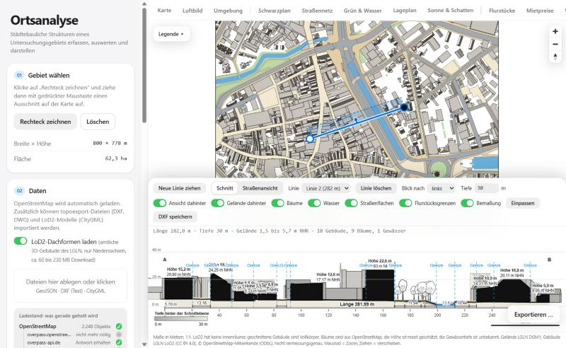

---

## Die Reiter im Einzelnen

Die Reiter sind nach Arbeitsablauf geordnet: **Orientierung → Pläne und Sonne → Grundstück und Markt → Darstellung → Zahlen.**

### 1. Orientierung

**Luftbild** – amtliche Orthofotos (DOP20, 20 cm) mit schaltbaren Überlagerungen (Gebäudeumrisse, Flurstücksgrenzen, Straßen), Deckkraft-Regler und Schwarz-Weiß-Schalter.
Nur Niedersachsen; es sind Flugzeugaufnahmen, keine Satellitenbilder.

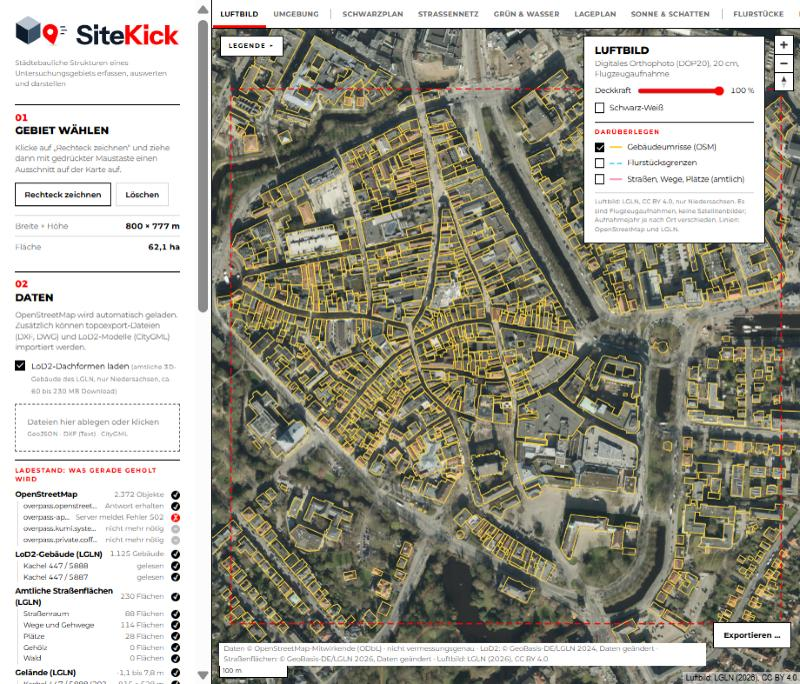

**Umgebung** – Orte aus OpenStreetMap, einzeln ein- und ausschaltbar, in Oberkategorien geordnet: Kinder und Bildung, Einkaufen, Verkehr (mit Bahnstrecken und Gleisen),
Gesundheit, Essen/Kultur/Freizeit, Öffentliche Einrichtungen. Ein Klick auf einen Punkt zeigt Einzelheiten. Zusätzlich:

- **Denkmalgeschützte Gebäude** (aus OpenStreetMap, unvollständig),
- **Erreichbarkeit zu Fuß:** Mittelpunkt anklicken, dann erscheinen Kreise für 5, 10 und 15 Minuten (400, 800, 1.200 m Luftlinie bei 4,8 km/h, **ohne echtes Wegenetz**).

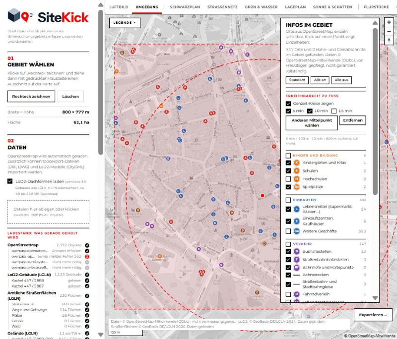

### 2. Pläne und Sonne

**Schwarzplan** – Gebäude schwarz auf weiß (Figur-Grund), Nebengebäude getrennt in Grau. Der Schalter **„Nach Höhe“** färbt die Gebäude in fünf Grautönen nach Höhe
(bis 6, 12, 18 und 25 m, darüber). Die Höhe stammt aus LoD2, sonst aus OpenStreetMap (Höhe oder Geschosse mal 3 m), sonst ist sie angenommen.

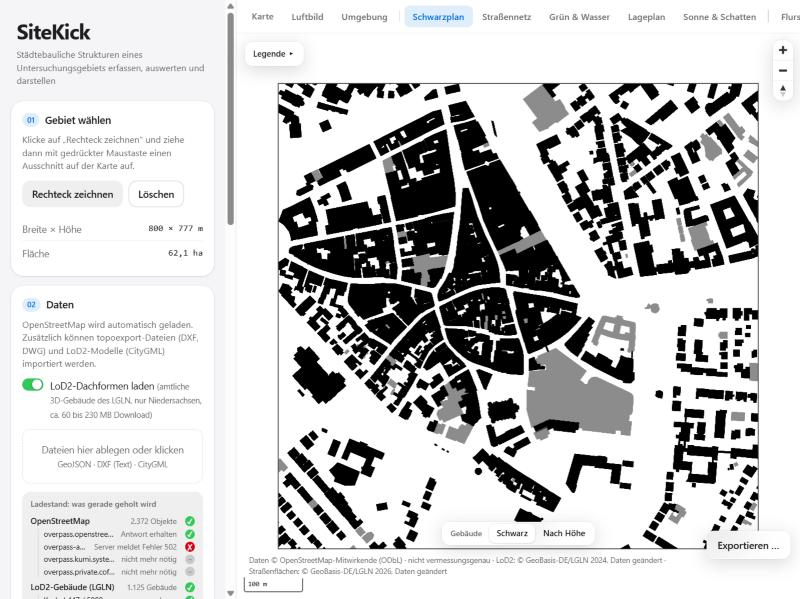

**Straßennetz** – amtliche Straßenflächen aus ALKIS (Fahrbahn, Weg, Platz getrennt) und Straßenbreite nach Straßenart.


**Grün & Wasser** – Grünflächen, Wälder, Gewässer und Einzelbäume mit Kronengröße.

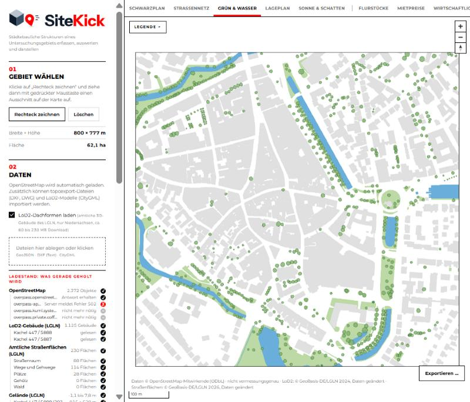

**Lageplan** – alles zusammen: Gebäude (bei LoD2 mit Dachflächen), Straßen, Grün, Wasser, Bäume. Mit Legende, Maßstabsleiste und Quellenangabe.

**Sonne & Schatten** – Zwei Darstellungen auf dem Lageplan, für jedes Datum:

- **Schatten:** Schattenplan für Datum und Uhrzeit (Regler), mit Sonnenhöhe, Himmelsrichtung und dem Anteil der Freifläche im Schatten.
  Schnellauswahl für 21. März, 21. Juni, 21. September und 21. Dezember.
- **Besonnungsdauer:** Wie viele Stunden direkte Sonne jeder Punkt an dem Tag bekommt (Farbskala 0 bis 14 Stunden, Auswertung mit Mittelwert und Anteil mit mindestens 4 Stunden).
  Ein Klick auf die Karte zeigt den Wert an der Stelle.

Gerechnet wird mit Gebäuden (LoD2-Dächer), Bäumen (Krone mit Unterkante, abschaltbar) und Gelände (DGM1) in einem feinen Raster: Schatten **0,5 m**, Besonnungsdauer **1 m**
(einstellbar von 2 m bis 0,5 m; beim Ziehen des Zeitreglers rechnet das Tool kurz grob mit 2 m, damit es flüssig bleibt). Der Sonnenstand kommt aus der astronomischen Formel
(Genauigkeit etwa 0,1 Grad), die Uhrzeit ist MEZ im Winter und MESZ im Sommer.

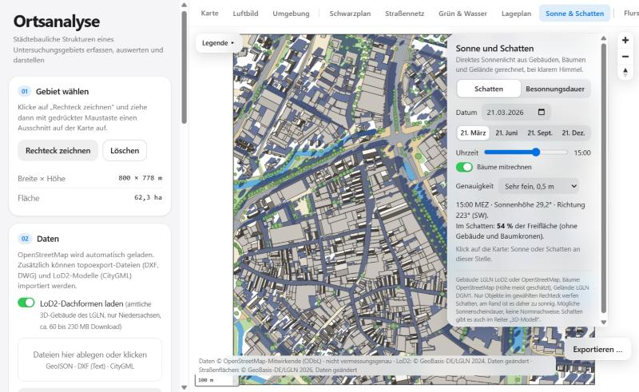
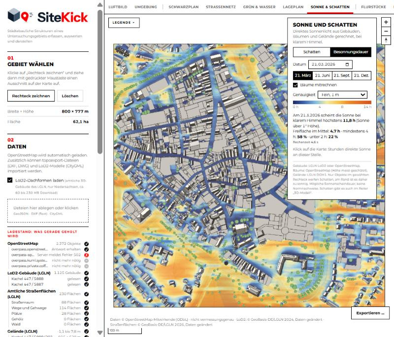

### 3. Grundstück und Markt

**Flurstücke** – amtliche Flurstücke mit **Bodenrichtwert** (BORIS), Bestand aus den Gebäuden (**GRZ, GFZ, Geschosse**) und dem Bodenwert zur Orientierung.
Einfärben nach Bodenrichtwert, GRZ oder GFZ. Ein Klick auf ein Flurstück zeigt alle Zahlen und woher sie stammen.

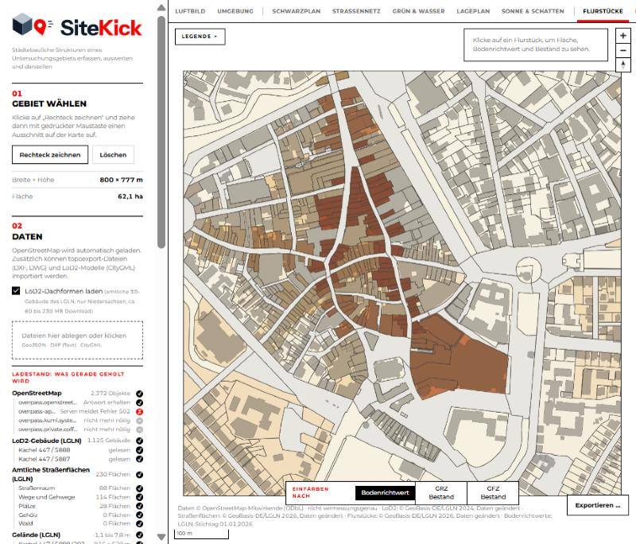

**Mietpreise** – Nettokaltmiete je m² aus dem Zensus 2022 im 100-m-Raster, dazu Wohnungsgröße, Baujahr und Einwohner je Zelle.
Das sind **Bestandsmieten von 2022, keine Angebotsmieten.**

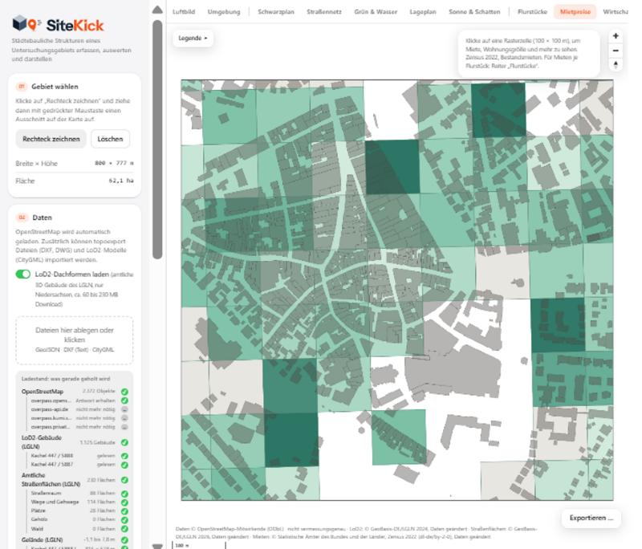

**Wirtschaftlichkeit** – Steckbrief und Überschlagsrechnung **je Flurstück**: Ertragswert des Bestands und Neubau-Potenzial mit Residualwert.
Jeder Rechenwert hat eine **Quelle** und eine **Art** (amtlich, Marktangabe oder Annahme) und lässt sich pro Flurstück ändern.
Standardwerte u. a. aus den Landesgrundstücksmarktdaten Niedersachsen, der ImmoWertV, dem Bewertungsgesetz, dem Mietspiegel Oldenburg 2025 und dem Baupreisindex.


> **Wichtig:** Das ist eine Überschlagsrechnung zum Lernen und Vergleichen, **kein Gutachten und keine Anlageberatung.**
> Die Richtwert-GFZ ersetzt keinen Bebauungsplan; ein Bebauungsplan ist nicht eingebunden.

### 4. Darstellung

**Schnitt & Ansicht** – Linie auf der Karte ziehen, dann entsteht ein **senkrechter Schnitt** durch Gelände (DGM1), Gebäude (LoD2), Straßenflächen,
Flurstücksgrenzen, Bäume und Wasser, mit Maßketten und Gebäudehöhen. Die **Tiefe** (wie weit man hinter die Linie schaut) ist als Band auf der Karte
und als Skala in der Zeichnung zu sehen. „Blick nach links/rechts“ wechselt die Seite. Geschnittene Gebäude erscheinen schwarz als Vollkörper (Poché).
Es lassen sich **mehrere Linien** ziehen und über das Feld „Linie“ wechseln; die anderen Linien stehen grau gestrichelt auf der Karte.


Mit dem Schalter **Straßenansicht** sieht man stattdessen die Gebäudefassaden hinter der Linie (aus den LoD2-Flächen, nach Entfernung abgestuft).

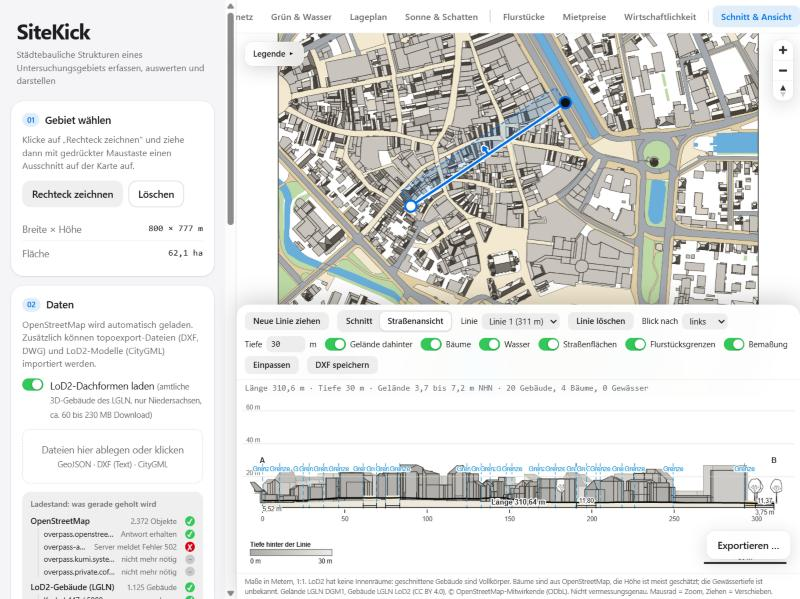

**3D-Modell** – Gebäude mit echten Dachformen (LoD2), Gelände mit Höhenlinien, Bäume. Drehen mit der Maus, Draufsicht, Überhöhung, Bild speichern.
Mit dem Haken **„Sonne“** werfen alle Gebäude und Bäume Schatten nach Datum und Uhrzeit (gleiche Einstellung wie im Reiter „Sonne & Schatten“).


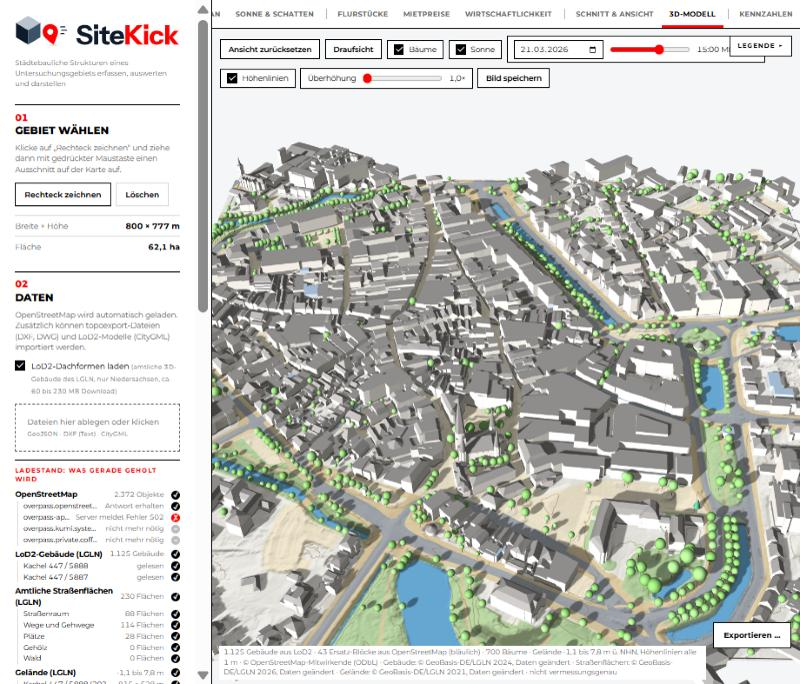

### 5. Zahlen

**Kennzahlen** – Fläche, Gebäudezahl, bebaute Fläche, **GRZ und GFZ brutto (ganzes Gebiet) und netto (nur Bauland ohne Verkehr, Grün, Wasser)**,
Grünanteil, Kronenüberdeckung u. a. Mit Hinweisen zur Genauigkeit, Knopf „Kennzahlen als Text kopieren“ und Export als PDF und CSV.


---

## Export

Unten rechts im Tool steht in jedem Reiter der Knopf **„Exportieren …“**. In Karte ist er ausgegraut, in allen anderen Reitern gilt er für die gerade offene Ansicht.
Es öffnet sich ein Fenster mit **Vorschau**:

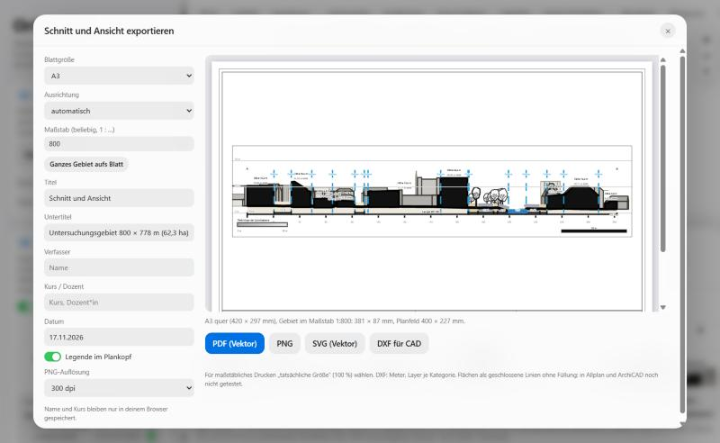

- **Blatt:** A4 bis A0, quer, hoch oder automatisch.
- **Maßstab:** frei wählbar (1 : beliebige Zahl). Der Knopf „Ganzes Gebiet aufs Blatt“ wählt den kleinsten runden Maßstab, bei dem alles passt.
  Ist das Gebiet größer als das Blatt, zeigt das Blatt einen **Ausschnitt**, den man im Vorschaubild **mit der Maus verschiebt** („Ausschnitt zentrieren“ stellt die Mitte wieder ein).
  Nichts ragt über das Planfeld hinaus.
- **Plankopf:** Titel, Untertitel, Maßstab, Datum, Verfasser, Kurs/Dozent, Legende, Nordpfeil, Maßstabsleiste, Quellen und Lizenzen.
  Verfasser und Kurs bleiben nur in deinem Browser gespeichert.

| Reiter | Formate |
|---|---|
| Schwarzplan, Straßennetz, Grün & Wasser, Lageplan, Umgebung | PDF (Vektor), PNG (150/300 dpi), SVG (Vektor), **DXF für Allplan 2024 und ArchiCAD 29**, GeoJSON (Umgebung auch CSV-Liste der Orte) |
| Sonne & Schatten | PDF, PNG, SVG, DXF (nur der Lageplan; die Schatten sind ein Pixelbild und stehen nur in PDF, PNG und SVG) |
| Flurstücke, Mietpreise, Wirtschaftlichkeit | PDF, PNG, SVG, DXF Allplan/ArchiCAD, GeoJSON, CSV (Tabelle für Excel); die Einfärbung entspricht der gewählten Karte |
| Luftbild | PDF, PNG, SVG: Foto (25 cm je Pixel) mit den angehakten Linien. Kein DXF, ein Foto hat keine CAD-Linien |
| Schnitt & Ansicht | PDF, PNG, SVG mit Plankopf im gewählten Maßstab (Beschriftung passt sich an), DXF mit X = Abstand entlang der Linie und Y = Höhe über NHN |
| 3D-Modell | PDF, PNG, SVG (Bild mit Plankopf, ohne Maßstab); **3D-DXF für Allplan und ArchiCAD** mit LoD2-Wänden und -Dächern als 3D-Flächen und dem Gelände als 5-m-Netz (Höhen über NHN) |
| Kennzahlen | PDF (A4-Seiten) und CSV |

**Beispiele für exportierte Blätter** (PNG, A3):

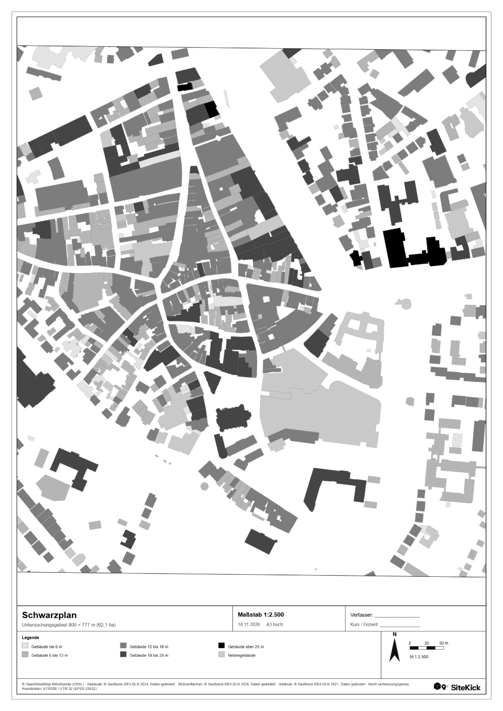
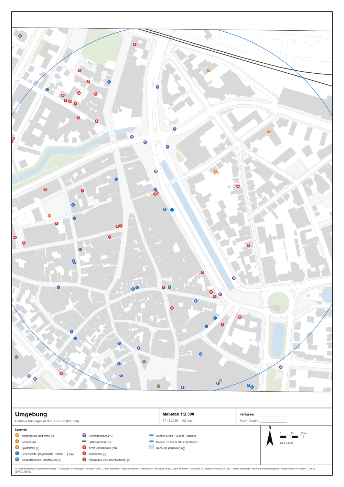
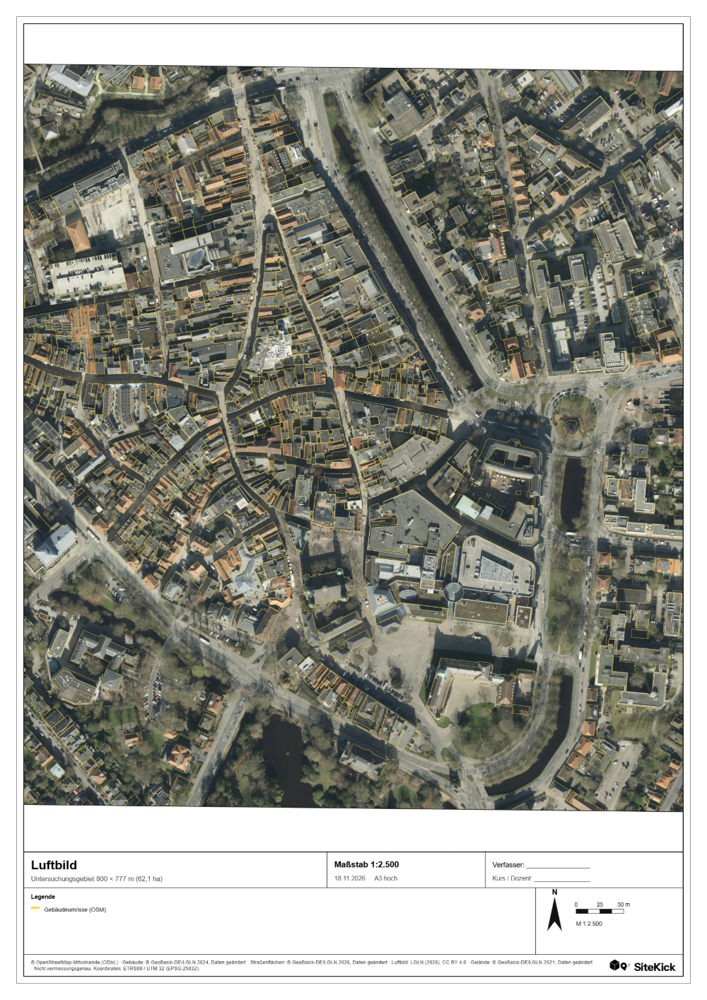
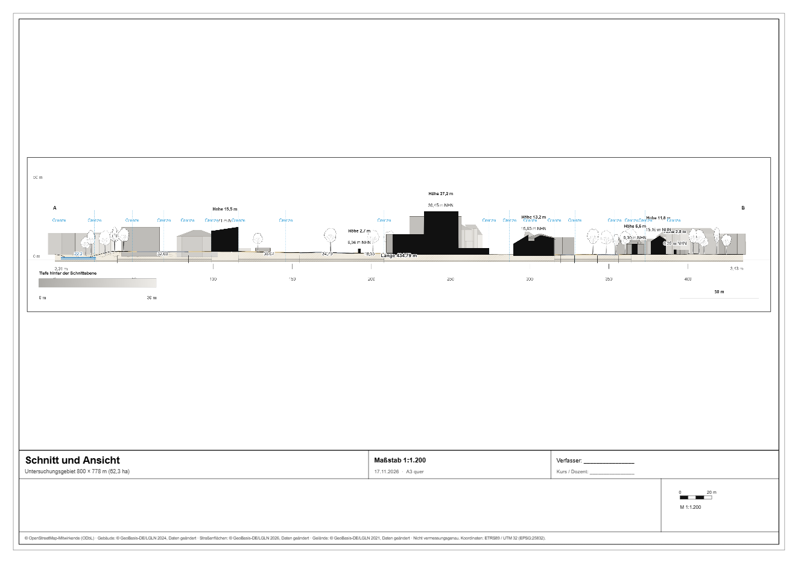
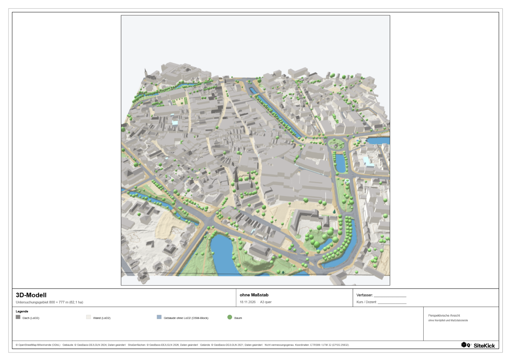

**DXF-Dateien:** Version R12 (AC1009), Einheit Meter, ein Layer je Kategorie (ohne Umlaute und Leerzeichen), Flächen als geschlossene Linien **ohne Füllung**, Quellenangabe als Text im Layer `BESCHRIFTUNG`.
Allplan bekommt absolute UTM-32-Koordinaten, ArchiCAD einen lokalen Nullpunkt (UTM minus Bezugspunkt, die Bezugskoordinaten stehen als Text in der Datei).
Alle DXF-Dateien wurden mit der Python-Bibliothek ezdxf auf Gültigkeit geprüft. **In Allplan und ArchiCAD sind sie noch nicht getestet.**

Der Maßstab stimmt auf dem Papier nur, wenn beim Drucken „tatsächliche Größe“ (100 %) gewählt wird.

---

## Datei-Import und Projekt merken

**Import** (Feld „Dateien hier ablegen“ in der Seitenleiste, oder klicken):

| Datei | Was passiert |
|---|---|
| **GeoJSON** (`.geojson`, `.json`) | Flächen, Linien, Punkte erscheinen orange über den Karten-Reitern und im Plan-Export als Ebene `IMPORT_<Name>`. Länge/Breite oder UTM 32 wird erkannt. |
| **DXF im Text-Format** (`.dxf`) | LINE, LWPOLYLINE, POLYLINE, CIRCLE, POINT, 3DFACE werden gelesen. Sind die Koordinaten UTM, wird das erkannt; sonst fragt das Tool nach dem **Bezugspunkt** (Ost, Nord in UTM 32) des Nullpunkts. |
| **CityGML** (`.gml`, `.xml`) | LoD2-Gebäude einer eigenen Datei **ersetzen** die vom LGLN geladenen (neu „Analysieren“ stellt die LGLN-Daten wieder her). Quelle und Lizenz der Datei muss man selbst prüfen. |
| binäres DXF (topoexport), DWG | werden abgelehnt, mit Anleitung, die Datei im CAD-Programm als Text-DXF zu speichern |

**Projekt merken:** Das Tool merkt sich automatisch den letzten Stand **in diesem Browser**: Gebiet, offenen Reiter, Sonnen-Einstellungen, Einfärbungen, Luftbild-Einstellungen,
Gehzeit-Kreise, Schnittlinien, LoD2 an/aus. Beim nächsten Öffnen erscheint links der Kasten **„Wiederherstellen“**; die Geodaten werden dabei neu geladen.
Die Orte der Umgebung, die Werte der Wirtschaftlichkeit und die Export-Angaben merken sich ihre Reiter selbst. Das Merken gilt nur für diesen Rechner und diesen Browser.

---

## Datenquellen und Lizenzen

Alle Daten werden beim Analysieren live aus dem Netz geholt; im Repository liegen keine Geodaten. **Die Quellenangaben stehen im Tool immer
sichtbar unten auf der Karte und in den Exporten.**

| Was | Quelle | Lizenz / Hinweis |
|---|---|---|
| Kartengrundlage, Gebäude, Grün, Wasser, Bäume, Orte (Umgebung), Denkmäler | © OpenStreetMap-Mitwirkende, über die Overpass-API | ODbL |
| Straßen-, Wege-, Platzflächen und Flurstücke | LGLN, ALKIS (WFS `alkis_wfs_sf`) | CC BY 4.0, „Daten geändert“ |
| Bodenrichtwerte | LGLN, BORIS (WFS `boris_wfs`), Stichtag 01.01.2026 | CC BY 4.0 |
| Gebäude mit Dachformen (LoD2) | LGLN, Kachelsuche über den STAC-Dienst | © GeoBasis-DE/LGLN, „Daten geändert“ (CC BY 4.0) |
| Gelände (DGM1, 1-m-Raster) | LGLN, STAC-Dienst | © GeoBasis-DE/LGLN, „Daten geändert“ (CC BY 4.0) |
| Luftbilder (DOP20) | LGLN, WMS `dop_wms` | CC BY 4.0 |
| Mieten, Wohnungsgröße, Baujahr (100-m-Raster) | Zensus 2022, © Statistische Ämter des Bundes und der Länder | dl-de/by-2-0, „Daten geändert“; abgefragt über eine offene Kopie (Esri-Dienst `Zensus2022_grid_final`) |
| Rechenwerte der Wirtschaftlichkeit | siehe Reiter, je Feld mit Quelle | u. a. Gutachterausschüsse Niedersachsen, ImmoWertV, BewG, Mietspiegel Oldenburg 2025, Destatis |

Die Hintergrundkarte kommt von den OSM-Kartenservern. Für ein Studienprojekt ist das in Ordnung; bei vielen Nutzer\*innen müsste man einen anderen Kartendienst nehmen.

---

## Genauigkeit und Grenzen

Ehrlich gesagt, was das Tool **nicht** kann:

- **Nicht vermessungsgenau.** Die Daten sind für Entwurf, Lehre und Überblick gedacht, nicht für Genehmigung oder Vermessung.
- **Nur Niedersachsen** hat Dachformen (LoD2), Gelände, Luftbilder, Flurstücke und Bodenrichtwerte. Außerhalb liefert das Tool vor allem OpenStreetMap-Daten
  (Gebäude als Blöcke); die Zensus-Mieten gibt es bundesweit. Entwickelt und getestet wurde in Oldenburg.
- **Höchstens 1 km²** pro Analyse.
- **OpenStreetMap ist von Freiwilligen gepflegt** und nicht überall vollständig. Gebäudehöhen und Geschosse fehlen oft und werden dann geschätzt. Denkmäler sind nur die, die in OpenStreetMap eingetragen sind.
- **Bäume:** Position aus OpenStreetMap; die Höhe ist meist geschätzt (zweifache Kronenbreite), die Kronenform ist schematisch.
- **Sonne und Schatten:** Nur Gebäude und Bäume im gewählten Rechteck werfen Schatten, am Rand sind die Flächen daher zu sonnig. Bäume zählen im Winter wie im Sommer als undurchsichtig
  (zu viel Schatten bei Laubbäumen im Winter), ihre Höhe ist meist geschätzt. Dachüberstände, Balkone und Zäune fehlen, das Raster ist 0,5 bis 1 m fein. Es ist die mögliche Sonnenscheindauer bei klarem
  Himmel, **kein Nachweis nach Norm** (DIN 5034) und kein Gutachten.
- **Erreichbarkeit zu Fuß:** Die Kreise sind Luftlinie (80 m je Minute), keine echten Fußwege. Umwege, Gebäude und Bahnlinien zählen nicht.
- **Schnitt:** LoD2 hat keine Innenräume, geschnittene Gebäude sind deshalb Vollkörper. Die Gewässertiefe ist unbekannt (nur Wasserlinie dargestellt). Das Gelände hinter der Linie
  ist nur im Höhenraster vorhanden.
- **Mieten** sind Bestandsmieten 2022 im 100-m-Raster, keine aktuellen Angebotsmieten. Je Flurstück sind sie eine Schätzung aus dem Raster.
- **Wirtschaftlichkeit:** Überschlag ohne Gutachterqualität. Baukosten nach Normalherstellungskosten liegen oft unter den Marktpreisen. Ein Bebauungsplan fehlt.
- **Fremdserver:** Fällt einer der Datendienste aus (z. B. ein Overpass-Server), erscheint eine Meldung im Ladestand; das Tool probiert mehrere Overpass-Server nacheinander.
- **Export:** Das DXF kennt keine Füllungen und keine Pixelbilder (Schatten, Luftbild). Die 3D-DXF ist groß (etwa 16 MB für 62 ha). Sehr große Blätter (A0 als PNG) werden automatisch in der Auflösung verringert.
  Das Luftbild lädt das Tool beim Export neu vom Dienst des LGLN, dazu braucht es Internet.
- **Import:** DWG und das binäre topoexport-DXF kann der Browser nicht lesen (als Text-DXF speichern). Beim DXF-Import fehlen Blöcke, Texte, Bemaßungen und Schraffuren. Importierte GeoJSON- und DXF-Dateien bleiben nicht über das Neuladen der Seite hinaus erhalten.
- **Nicht getestet:** Smartphone, andere Browser als Chrome/Edge, DXF in Allplan und ArchiCAD, CityGML-Import mit einer echten Datei, Text-DXF mit lokalen Koordinaten, sehr große oder dicht bebaute Gebiete.

---

## Technik und Aufbau

Reine Website aus HTML, CSS und JavaScript, **kein Build-Schritt, kein eigener Server** (`server.py` ist nur ein Hilfsserver für den lokalen Start, der das Zwischenspeichern ausschaltet).
Bibliotheken kommen per CDN: [MapLibre GL JS](https://maplibre.org/) 4.7.1 (Karte), [Turf.js](https://turfjs.org/) 7.1.0 (Flächen und Längen),
[osmtogeojson](https://github.com/tyrasd/osmtogeojson) (OSM-Daten umwandeln), [proj4js](http://proj4js.org/) (UTM 32 ↔ Länge/Breite),
[three.js](https://threejs.org/) 0.147 (3D), [jsPDF](https://github.com/parallax/jsPDF) 2.5.1 (PDF-Export) und [geotiff.js](https://geotiffjs.github.io/) (Geländemodell).
Koordinaten amtlicher Daten: ETRS89 / UTM 32 (EPSG:25832).

| Datei | Inhalt |
|---|---|
| `index.html`, `style.css` | Oberfläche und Gestaltung (Apple-Stil, Hell und Dunkel, alle Farben als Variablen) |
| `app.js` | Karte, Gebiet zeichnen, Datenabruf (OSM, ALKIS), Pläne, Kennzahlen |
| `lod2-worker.js` | liest die LoD2-Kacheln im Hintergrund |
| `gelaende.js` | Geländemodell DGM1 |
| `flurstuecke.js`, `mieten.js`, `wirtschaft.js` | Flurstücke und Bodenrichtwert, Mietraster, Wirtschaftlichkeit |
| `luftbild.js`, `infos.js` | Luftbild und Umgebung |
| `erreichbar.js` | Gehzeit-Kreise |
| `schnitt.js` | Schnitt, Straßenansicht, mehrere Linien, DXF des Schnitts |
| `sonne.js` | Sonnenstand, Schattenplan, Besonnungsdauer |
| `hoehe.js` | Schwarzplan nach Höhe |
| `export.js` | Export-Fenster: Blatt, Maßstab, Plankopf, PDF/PNG/SVG/DXF/GeoJSON/CSV |
| `import.js`, `projekt.js` | Datei-Import, Projekt im Browser merken |
| `ansicht3d.js` | 3D-Modell (auch mit Schatten) |
| `ladeleiste.js`, `legende.js` | Ladestand und Legenden |
| `Start.bat`, `server.py` | lokaler Start unter Windows |
| `PLAN.md` | Planung, Entscheidungen und ausführlicher Arbeitsstand |
| `CLAUDE.md` | Regeln und technische Festlegungen für die Arbeit mit dem Coding-Agenten |
| `docs/bilder/` | Screenshots für diese README |

---

## Hinweis zur Nutzung von KI

Dieses Projekt wurde **mit Unterstützung von KI** entwickelt. Der Programmcode wurde mit dem Coding-Agenten **Claude Code** (Anthropic) geschrieben,
im Dialog mit den Studierenden: Die Studierenden haben Idee, Funktionsumfang, Gestaltung und Prüfung der Ergebnisse verantwortet, der Agent hat auf Anfrage
den Code erzeugt und getestet. Die Arbeitsregeln für den Agenten stehen in [`CLAUDE.md`](CLAUDE.md), der Verlauf in [`PLAN.md`](PLAN.md).

_[Hier die Angaben ergänzen, die die Hochschule für den Nachweis der KI-Nutzung verlangt, z. B. Version/Modell, Zeitraum, Anteil, Prüfung der Ergebnisse.]_

Die Rechenwerte der Wirtschaftlichkeit sind mit Quellen belegt, die Rechnungen wurden von Hand nachgerechnet. Trotzdem gilt: **Alle Ergebnisse sind
Überschläge und müssen vor jeder Verwendung selbst geprüft werden.**

---

## Offen

Alle geplanten Funktionen sind umgesetzt. Offen sind Tests, die nur mit den Programmen oder Geräten gehen: die DXF-Dateien in Allplan und ArchiCAD öffnen, der CityGML-Import
mit einer echten Datei, Smartphone und andere Browser (Firefox, Safari) sowie die Oberfläche im Dunkelmodus in den Reitern 3D-Modell und Mietpreise.
Zum Abgeben noch auszufüllen: Namen, Kurs, Datum und der KI-Nachweis oben in dieser README.

---

*Kartengrundlage © OpenStreetMap-Mitwirkende (ODbL). Weitere Quellen: LGLN Niedersachsen (CC BY 4.0), Statistische Ämter des Bundes und der Länder (dl-de/by-2-0). Daten nicht vermessungsgenau.*
