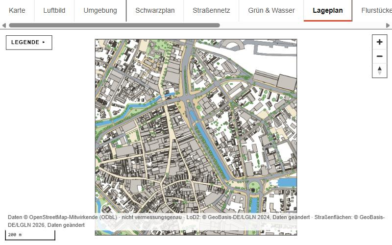
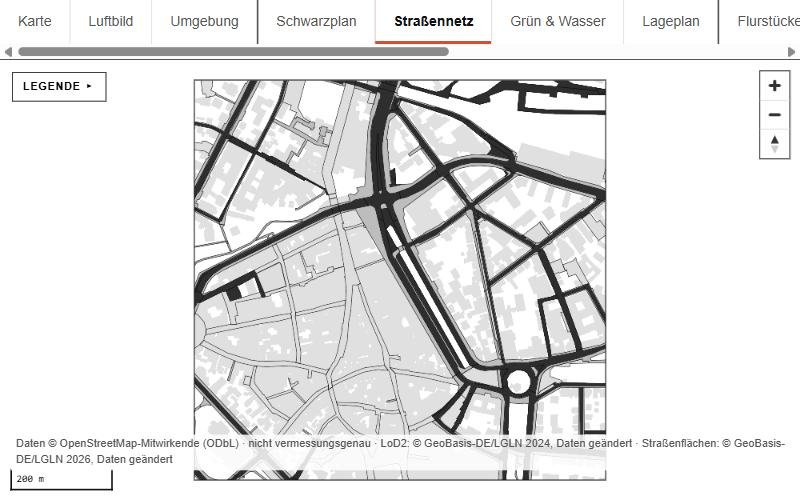
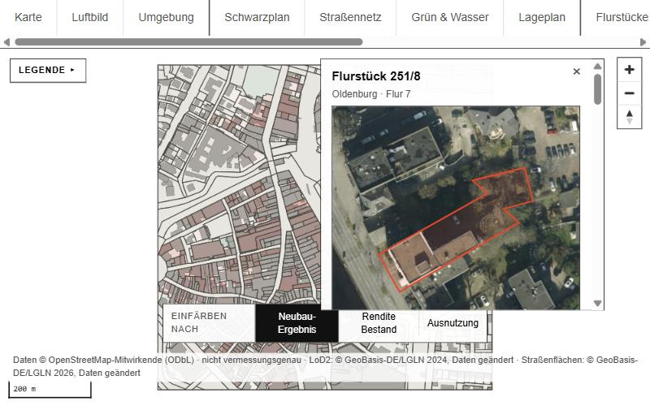
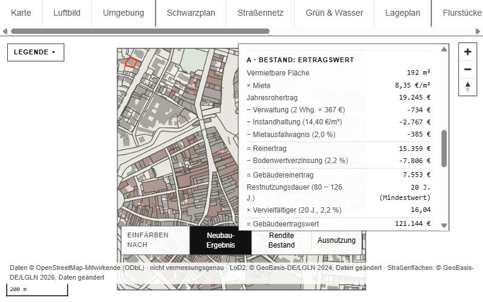
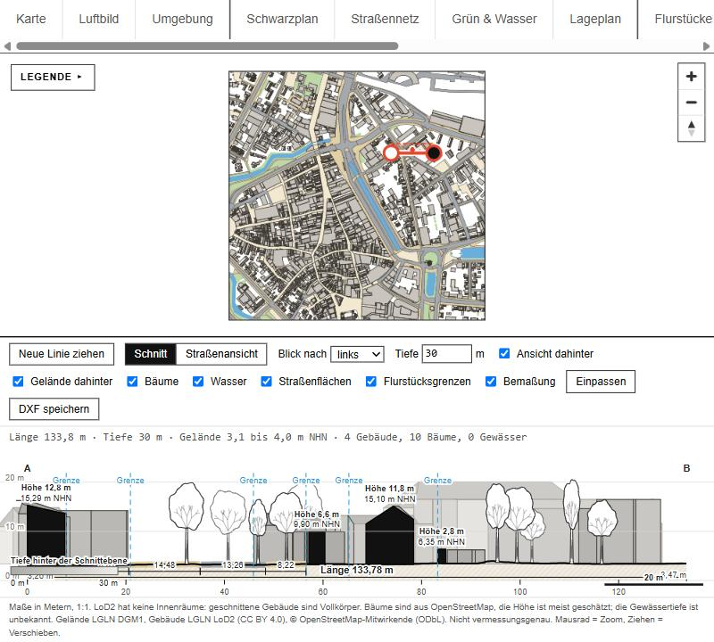
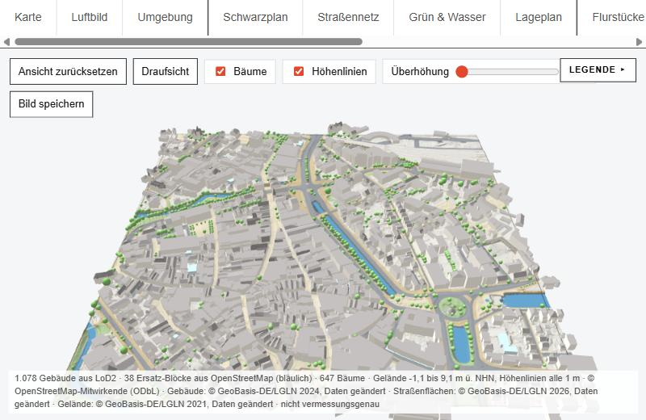
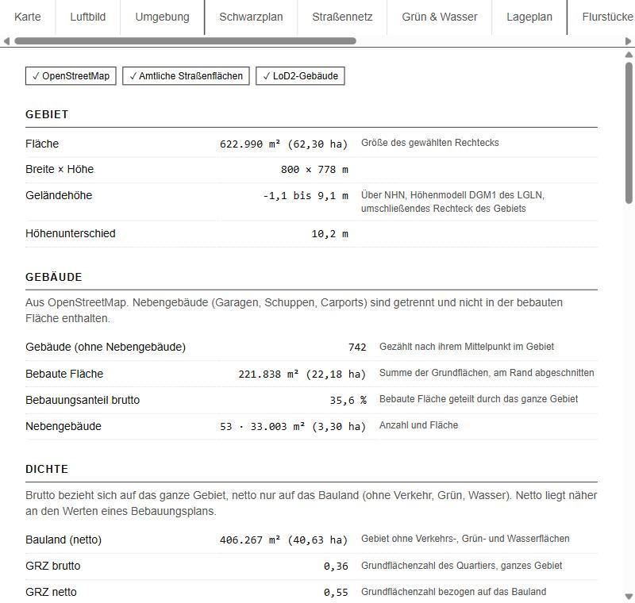

# Ortsanalyse – Mapping-Tool für Architektur

Eine Website, mit der man auf einer Karte ein Gebiet von bis zu 1 km² aufzieht und daraus automatisch
**Schwarzplan, Straßennetz, Grünplan, Lageplan, 3D-Modell, Schnitt und Ansicht, Flurstücke mit Bodenrichtwerten,
Mietpreise, eine Überschlagsrechnung zur Wirtschaftlichkeit und Kennzahlen** bekommt.
Entstanden als Studienprojekt für Architekturstudierende. Die Daten kommen automatisch aus offenen Quellen
(OpenStreetMap und dem Landesamt für Geoinformation Niedersachsen, LGLN). Es gibt nichts zu installieren außer Python zum lokalen Start.



*Lageplan des Testgebiets Oldenburg Innenstadt (800 × 778 m), erzeugt mit dem Tool.*

| | |
|---|---|
| **Projekt von** | _[Namen der Gruppe eintragen]_ |
| **Kurs / Dozent\*in** | _[Kurs und Dozent\*in eintragen]_ |
| **Stand** | _[Datum der Abgabe eintragen]_ |
| **Lizenz** | Apache License 2.0 (siehe [`LICENSE`](LICENSE)) |

---

## Inhalt

1. [Schnellstart](#schnellstart)
2. [Was das Tool kann (alle Reiter)](#was-das-tool-kann)
3. [Export](#export)
4. [Datenquellen und Lizenzen](#datenquellen-und-lizenzen)
5. [Genauigkeit und Grenzen](#genauigkeit-und-grenzen)
6. [Technik und Aufbau](#technik-und-aufbau)
7. [Hinweis zur Nutzung von KI](#hinweis-zur-nutzung-von-ki)
8. [Geplant](#geplant)

---

## Schnellstart

**Variante A: lokal auf dem eigenen Rechner (Windows)**

1. [Python](https://www.python.org/downloads/) installieren (einmalig). Beim Installieren „Add python.exe to PATH“ anhaken.
2. Dieses Repository herunterladen (grüner Knopf „Code“ → „Download ZIP“) und entpacken.
3. Im Ordner auf **`Start.bat`** doppelklicken. Es öffnet sich der Browser mit dem Tool
   (Adresse: `http://localhost:8765/index.html`). Das schwarze Fenster offen lassen, zum Beenden schließen.

Ohne Windows reicht im Ordner dieser Befehl, danach `http://localhost:8765/index.html` im Browser öffnen:

```bash
python server.py 8765
```

**Variante B: im Browser über GitHub Pages**

Die Seite ist reine HTML/CSS/JavaScript-Technik und braucht keinen eigenen Server. Sobald GitHub Pages für dieses Repository
aktiviert ist, steht das Tool unter `https://jade-hs-vibecoding-wpk.github.io/Mapping-Tool-Architektur/`.
_Hinweis: Das ist noch nicht getestet. Verlässlich ist bisher nur der lokale Start (Variante A)._

**Benutzung in vier Schritten**

1. **Gebiet wählen:** „Rechteck zeichnen“ klicken und mit gedrückter Maustaste auf der Karte ein Rechteck aufziehen (höchstens 1 km²).
2. **Analysieren:** Den Knopf „Analysieren“ klicken. Das Tool lädt die Daten (mit den 3D-Dachformen etwa 40 Sekunden, ohne LoD2 deutlich schneller).
   Der Ladestand zeigt, welche Quelle gerade geholt wird.
3. **Reiter durchklicken:** Alle Ansichten benutzen dieselben Daten. Oben die Reiter wechseln.
4. **Kennzahlen, Bilder und DXF** mitnehmen (siehe [Export](#export)).

Die Dachformen (LoD2) gibt es nur in Niedersachsen. Wer das Häkchen „LoD2-Dachformen laden“ wegnimmt, bekommt
eine schnellere Analyse mit einfachen Gebäudeblöcken.

---

## Was das Tool kann

Die Reiter sind nach Arbeitsablauf geordnet: **Orientierung → Pläne → Grundstück und Markt → Darstellung → Zahlen.**

### 1. Orientierung

**Luftbild** – amtliche Orthofotos (DOP20, 20 cm) mit schaltbaren Überlagerungen (Gebäudeumrisse, Flurstücksgrenzen, Straßen) und Deckkraft-Regler.
Nur Niedersachsen; es sind Flugzeugaufnahmen, keine Satellitenbilder.


**Umgebung** – Orte aus OpenStreetMap, einzeln ein- und ausschaltbar: Kindergärten, Schulen, Spielplätze, Läden, Haltestellen, Bahnhöfe, Bahnstrecken und mehr.
Die Oberkategorien lassen sich auch als Ganzes schalten. Ein Klick auf einen Punkt zeigt Einzelheiten.


### 2. Pläne

**Schwarzplan** – Gebäude schwarz auf weiß (Figur-Grund), Nebengebäude getrennt in Grau.


**Straßennetz** – amtliche Straßenflächen aus ALKIS (Fahrbahn, Weg, Platz getrennt) und Linienstärke nach Straßenart.



**Grün & Wasser** – Grünflächen, Wälder, Gewässer und Einzelbäume mit Kronengröße.


**Lageplan** – alles zusammen: Gebäude (bei LoD2 mit Dachflächen), Straßen, Grün, Wasser, Bäume. Mit Legende, Maßstabsleiste und Quellenangabe.

### 3. Grundstück und Markt

**Flurstücke** – amtliche Flurstücke mit **Bodenrichtwert** (BORIS), Bestand aus den Gebäuden (**GRZ, GFZ, Geschosse**) und dem Bodenwert zur Orientierung.
Einfärben nach Bodenrichtwert, GRZ oder GFZ. Ein Klick auf ein Flurstück zeigt alle Zahlen und woher sie stammen.


**Mietpreise** – Nettokaltmiete je m² aus dem Zensus 2022 im 100-m-Raster, dazu Wohnungsgröße, Baujahr und Einwohner je Zelle.
Das sind **Bestandsmieten von 2022, keine Angebotsmieten.**


**Wirtschaftlichkeit** – Steckbrief und Überschlagsrechnung **je Flurstück**: Ertragswert des Bestands und Neubau-Potenzial mit Residualwert.
Jeder Rechenwert hat eine **Quelle** und eine **Art** (amtlich, Marktangabe oder Annahme) und lässt sich pro Flurstück ändern.
Standardwerte u. a. aus den Landesgrundstücksmarktdaten Niedersachsen, der ImmoWertV, dem Bewertungsgesetz, dem Mietspiegel Oldenburg 2025 und dem Baupreisindex.




> **Wichtig:** Das ist eine Überschlagsrechnung zum Lernen und Vergleichen, **kein Gutachten und keine Anlageberatung.**
> Die Richtwert-GFZ ersetzt keinen Bebauungsplan; ein Bebauungsplan ist nicht eingebunden.

### 4. Darstellung

**Schnitt & Ansicht** – Linie auf der Karte ziehen, dann entsteht ein **senkrechter Schnitt** durch Gelände (DGM1), Gebäude (LoD2), Straßenflächen,
Flurstücksgrenzen, Bäume und Wasser, mit Maßketten und Gebäudehöhen. Die **Tiefe** (wie weit man hinter die Linie schaut) ist als Band auf der Karte
und als Skala in der Zeichnung zu sehen. „Blick nach links/rechts“ wechselt die Seite. Geschnittene Gebäude erscheinen schwarz als Vollkörper (Poché).



Mit dem Schalter **Straßenansicht** sieht man stattdessen die Gebäudefassaden hinter der Linie (aus den LoD2-Flächen, nach Entfernung abgestuft).


**3D-Modell** – Gebäude mit echten Dachformen (LoD2), Gelände mit Höhenlinien, Bäume. Drehen mit der Maus, Draufsicht, Überhöhung, Bild speichern.



### 5. Zahlen

**Kennzahlen** – Fläche, Gebäudezahl, bebaute Fläche, **GRZ und GFZ brutto (ganzes Gebiet) und netto (nur Bauland ohne Verkehr, Grün, Wasser)**,
Grünanteil, Kronenüberdeckung u. a. Mit Hinweisen zur Genauigkeit und Knopf „Kennzahlen als Text kopieren“.



---

## Export

Was heute funktioniert:

| Was | Wo | Format |
|---|---|---|
| Schnitt oder Straßenansicht für CAD | Reiter „Schnitt & Ansicht“, Knopf „DXF speichern“ | DXF (R12, Meter, ohne Füllungen, Layer pro Kategorie, Quellenangabe im Layer `BESCHRIFTUNG`) |
| 3D-Ansicht als Bild | Reiter „3D-Modell“, Knopf „Bild speichern“ | PNG mit Quellenangabe |
| Kennzahlen | Reiter „Kennzahlen“, Knopf „Kennzahlen als Text kopieren“ | Text in der Zwischenablage |

Der DXF-Export wurde mit der Python-Bibliothek ezdxf auf Gültigkeit geprüft. **In Allplan und ArchiCAD ist er noch nicht getestet.**
Weitere Exporte (Pläne maßstäblich mit Plankopf, PDF, DXF für Allplan 2024 und ArchiCAD 29) sind geplant, siehe [Geplant](#geplant).

---

## Datenquellen und Lizenzen

Alle Daten werden beim Analysieren live aus dem Netz geholt; im Repository liegen keine Geodaten. **Die Quellenangaben stehen im Tool immer
sichtbar unten auf der Karte und in den Exporten.**

| Was | Quelle | Lizenz / Hinweis |
|---|---|---|
| Kartengrundlage, Gebäude, Grün, Wasser, Bäume, Orte (Umgebung) | © OpenStreetMap-Mitwirkende, über die Overpass-API | ODbL |
| Straßen-, Wege-, Platzflächen und Flurstücke | LGLN, ALKIS (WFS `alkis_wfs_sf`) | CC BY 4.0, „Daten geändert“ |
| Bodenrichtwerte | LGLN, BORIS (WFS `boris_wfs`), Stichtag 01.01.2026 | CC BY 4.0 |
| Gebäude mit Dachformen (LoD2) | LGLN, Kachelsuche über den STAC-Dienst | © GeoBasis-DE/LGLN, „Daten geändert“ (CC BY 4.0) |
| Gelände (DGM1, 1-m-Raster) | LGLN, STAC-Dienst | © GeoBasis-DE/LGLN, „Daten geändert“ (CC BY 4.0) |
| Luftbilder (DOP20) | LGLN, WMS `dop_wms` | CC BY 4.0 |
| Mieten, Wohnungsgröße, Baujahr (100-m-Raster) | Zensus 2022, © Statistische Ämter des Bundes und der Länder | dl-de/by-2-0, „Daten geändert“; abgefragt über eine offene Kopie (Esri-Dienst `Zensus2022_grid_final`) |
| Rechenwerte der Wirtschaftlichkeit | siehe Reiter, je Feld mit Quelle | u. a. Gutachterausschüsse Niedersachsen, ImmoWertV, BewG, Mietspiegel Oldenburg 2025, Destatis |

Die Hintergrundkarte kommt von den OSM-Kartenservern. Für ein Studienprojekt ist das in Ordnung; bei vielen Nutzer\*innen müsste man einen anderen Kartendienst nehmen.

---

## Genauigkeit und Grenzen

Ehrlich gesagt, was das Tool **nicht** kann:

- **Nicht vermessungsgenau.** Die Daten sind für Entwurf, Lehre und Überblick gedacht, nicht für Genehmigung oder Vermessung.
- **Nur Niedersachsen** hat Dachformen (LoD2), Gelände, Luftbilder, Flurstücke und Bodenrichtwerte. Außerhalb liefert das Tool vor allem OpenStreetMap-Daten
  (Gebäude als Blöcke); die Zensus-Mieten gibt es bundesweit. Entwickelt und getestet wurde in Oldenburg.
- **Höchstens 1 km²** pro Analyse.
- **OpenStreetMap ist von Freiwilligen gepflegt** und nicht überall vollständig. Gebäudehöhen und Geschosse fehlen oft und werden dann geschätzt.
- **Bäume:** Position aus OpenStreetMap; die Höhe ist meist geschätzt (zweifache Kronenbreite), die Kronenform ist schematisch.
- **Schnitt:** LoD2 hat keine Innenräume, geschnittene Gebäude sind deshalb Vollkörper. Die Gewässertiefe ist unbekannt (nur Wasserlinie dargestellt). Das Gelände hinter der Linie
  ist nur im Höhenraster vorhanden.
- **Mieten** sind Bestandsmieten 2022 im 100-m-Raster, keine aktuellen Angebotsmieten. Je Flurstück sind sie eine Schätzung aus dem Raster.
- **Wirtschaftlichkeit:** Überschlag ohne Gutachterqualität. Baukosten nach Normalherstellungskosten liegen oft unter den Marktpreisen. Ein Bebauungsplan fehlt.
- **Fremdserver:** Fällt einer der Datendienste aus (z. B. ein Overpass-Server), erscheint eine Meldung im Ladestand; das Tool probiert mehrere Overpass-Server nacheinander.
- **Nicht getestet:** Smartphone, andere Browser als Chrome/Edge, DXF in Allplan und ArchiCAD, sehr große oder dicht bebaute Gebiete.
- Der **Datei-Import** (topoexport-DXF, CityGML) ist in der Oberfläche nur angedeutet und noch nicht gebaut.

---

## Technik und Aufbau

Reine Website aus HTML, CSS und JavaScript, **kein Build-Schritt, kein eigener Server** (`server.py` ist nur ein Hilfsserver für den lokalen Start, der das Zwischenspeichern ausschaltet).
Bibliotheken kommen per CDN: [MapLibre GL JS](https://maplibre.org/) 4.7.1 (Karte), [Turf.js](https://turfjs.org/) 7.1.0 (Flächen und Längen),
[osmtogeojson](https://github.com/tyrasd/osmtogeojson) (OSM-Daten umwandeln), [proj4js](http://proj4js.org/) (UTM 32 ↔ Länge/Breite),
[three.js](https://threejs.org/) 0.147 (3D) und [geotiff.js](https://geotiffjs.github.io/) (Geländemodell).
Koordinaten amtlicher Daten: ETRS89 / UTM 32 (EPSG:25832).

| Datei | Inhalt |
|---|---|
| `index.html`, `style.css` | Oberfläche und Gestaltung |
| `app.js` | Karte, Gebiet zeichnen, Datenabruf (OSM, ALKIS), Pläne, Kennzahlen |
| `lod2-worker.js` | liest die LoD2-Kacheln im Hintergrund |
| `gelaende.js` | Geländemodell DGM1 |
| `flurstuecke.js`, `mieten.js`, `wirtschaft.js` | Flurstücke und Bodenrichtwert, Mietraster, Wirtschaftlichkeit |
| `luftbild.js`, `infos.js` | Luftbild und Umgebung |
| `schnitt.js` | Schnitt, Straßenansicht, DXF-Export |
| `ansicht3d.js` | 3D-Modell |
| `ladeleiste.js`, `legende.js` | Ladestand und Legenden |
| `PLAN.md` | Planung, Entscheidungen und ausführlicher Arbeitsstand |
| `CLAUDE.md` | Regeln und technische Festlegungen für die Arbeit mit dem Coding-Agenten |
| `docs/bilder/` | Screenshots für diese README |

---

## Hinweis zur Nutzung von KI

Dieses Projekt wurde **mit Unterstützung von KI** entwickelt. Der Programmcode wurde mit dem Coding-Agenten **Claude Code** (Anthropic) geschrieben,
im Dialog mit den Studierenden: Die Studierenden haben Idee, Funktionsumfang, Gestaltung und Prüfung der Ergebnisse verantwortet, der Agent hat auf Anfrage
den Code erzeugt und getestet. Die Arbeitsregeln für den Agenten stehen in [`CLAUDE.md`](CLAUDE.md), der Verlauf in [`PLAN.md`](PLAN.md).

_[Hier die Angaben ergänzen, die die Hochschule für den Nachweis der KI-Nutzung verlangt, z. B. Version/Modell, Zeitraum, Anteil, Prüfung der Ergebnisse.]_

Die Rechenwerte der Wirtschaftlichkeit sind mit Quellen belegt, die Rechnungen wurden von Hand nachgerechnet. Trotzdem gilt: **Alle Ergebnisse sind
Überschläge und müssen vor jeder Verwendung selbst geprüft werden.**

---

## Geplant

- Sonnen- und Verschattungsstudie (Datum und Uhrzeit einstellbar)
- Export maßstäblich mit Plankopf (A4 bis A0), als PDF, PNG und DXF, mit Voreinstellungen für **Allplan 2024** und **ArchiCAD 29**
- Schwarzplan nach Gebäudehöhe einfärbbar (ein- und ausschaltbar)
- Erreichbarkeit zu Fuß, denkmalgeschützte Gebäude in der Umgebung
- Mehrere Schnittlinien speichern, Projekt speichern und laden
- Datei-Import (topoexport-DXF, CityGML) mit Qualitätsvergleich

---

*Kartengrundlage © OpenStreetMap-Mitwirkende (ODbL). Weitere Quellen: LGLN Niedersachsen (CC BY 4.0), Statistische Ämter des Bundes und der Länder (dl-de/by-2-0). Daten nicht vermessungsgenau.*
